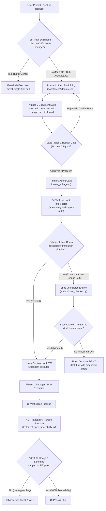

# Specification: Mechanical Spec-Gate & Traceability Enforcement

**Feature ID:** `2026-10-09-spec-gate-enforcement`  
**Requirement Range:** `REQ-031` to `REQ-035`  
**Status:** Approved by Human Gate  
**Governing Standard:** [`rules/spec-standard.md`](file:///Users/thanghoang/github/ai-review-plugin/rules/spec-standard.md)  
**Cross-Plugin Scope:** `ai-review-plugin` & `antigravity-attention-guard-plugin`  

---

## 1. Problem Statement & Background

### 1.1 The Incident: Conversational Momentum Bypass
On 2026-10-09 at 15:20, during the execution of PDF generation enhancements in the `agent-translator` plugin, a critical procedural failure occurred. The user requested:
> *"Add Table of Contents (TOC) and Book Index generation to the PDF compilation pipeline, update the scripts, but do not recompile yet."*

Under conversational momentum, the Primary Agent interpreted the prompt's negative constraint (*"do not recompile yet"*) and direct imperative framing as a fast-path exemption. Instead of entering Phase 1 Planning, scaffolding `docs/specs/2026-10-09-toc-index-generation/`, and requesting human sign-off, the Primary Agent immediately:
1. Created multiple new modules (`scripts/toc_builder.py`, `scripts/index_generator.py`).
2. Mutated existing compilation orchestrators (`scripts/compile_pdf.py`, `scripts/helper.py`).
3. Introduced new CLI flags (`--with-toc`, `--index-depth`, `--no-recompile`) that were completely undocumented.
4. Dispatched mutating subagents without establishing requirement IDs (`REQ-xxx`) or Architectural Decision Records (ADRs).

### 1.2 Root Cause Analysis
The failure stemmed from two systemic weaknesses:
1. **Ambiguous Rule Language:** Existing guidelines in `rules/spec-standard.md` permitted subjective interpretations of what constitutes a "quick one-off" or "direct user imperative", allowing multi-file features to slip through as ad-hoc prompt responses.
2. **Lack of Mechanical Enforcement:** Neither Antigravity hooks nor runtime guards intercepted `invoke_subagent` to verify whether an active, valid specification existed before code mutation subagents were dispatched. Without a physical interceptor, behavioral guidelines in markdown rules rely entirely on LLM self-discipline, which consistently degrades under conversational momentum.

---

## 2. High-Level Architecture

The Spec-Gate and Traceability architecture introduces a mechanical, fail-closed runtime barrier between conversational intent and subagent execution, coupled with continuous AST traceability verification in CI.



---

## 3. Normative Requirements

### REQ-031: Mechanical Pre-Tool Spec Gate on `invoke_subagent`
1. The `antigravity-attention-guard-plugin` SHALL register a `PreToolUse` hook matcher for `invoke_subagent` and `default_api:invoke_subagent`.
2. When triggered, the hook SHALL inspect the `Subagents` array in the tool arguments.
3. If any dispatched subagent is identified as a code executor or generic mutating agent (e.g., `TypeName == "self"`, role indicating execution, or prompt instructing file modification):
   - The hook SHALL invoke the shared specification verification engine (`spec_checker.py`).
   - If no valid, active specification package is found, the hook SHALL return `{"decision": "deny", "reason": "<diagnostic message>"}`.
   - The diagnostic message SHALL instruct the Primary Agent that code mutation requires an active specification in `docs/specs/<feature-id>/` registered in `docs/specs/INDEX.md`.
4. **Exemptions:** The hook SHALL explicitly exempt:
   - Read-only research subagents (`TypeName == "research"` or `Model == "flash_lite"` with read-only roles).
   - Book translation pipeline subagents (`translate`, `evaluate`, `refine`, `analyze`) operating within `runs/<book_slug>/`.

### REQ-032: Shared Specification Verification Engine (`spec_checker.py`)
1. The `ai-review-plugin` SHALL provide an authoritative Python module at `scripts/spec_checker.py`.
2. The module SHALL expose a public function:
   ```python
   def verify_active_specification(workspace_root: str) -> dict:
       ...
   ```
3. The function SHALL verify that:
   - `docs/specs/INDEX.md` exists and contains at least one specification with status in `{"Draft", "Planning", "In-Progress", "Approved"}`.
   - The active specification package directory `docs/specs/<feature-id>/` exists.
   - The mandatory Phase 1 documents exist within the package directory: `spec.md`, `decisions.md`, and `design.md`.
   - `spec.md` declares a valid requirement range (`REQ-xxx` to `REQ-yyy`).
4. The script SHALL provide a CLI entrypoint accepting `--workspace <path>`, `--json`, and `--quiet`, returning exit code `0` on valid active spec, `1` on missing/invalid active spec, and `2` on corrupt index or IO error.
5. `antigravity-attention-guard-plugin` SHALL consume `scripts/spec_checker.py` via CLI execution or Python import.

### REQ-033: Continuous Specification Traceability Fitness Function
1. The test suite SHALL include an architectural fitness function at `tests/test_spec_traceability.py`.
2. The fitness function SHALL use Python's built-in `ast` module to statically parse entrypoint scripts (`scripts/*.py`):
   - Traverse the AST to identify `argparse.ArgumentParser.add_argument()` invocations.
   - Extract all flag names (e.g., `--prior-review`, `--workspace`, `--diff-file`).
3. The fitness function SHALL scan all specification files in `docs/specs/**/spec.md` to extract declared requirement IDs (`REQ-\d+`) and their referenced configuration flags or CLI parameters.
4. The test SHALL assert that 100% of CLI flags detected via AST analysis map to an explicit requirement ID (`REQ-xxx`) in active or completed specs.
5. Any untraced CLI flag SHALL trigger an immediate test failure with the exact line number and flag name.

### REQ-034: Unambiguous Prompt Classification Invariants
1. `rules/spec-standard.md` SHALL define mathematically rigid criteria for the fast path:
   - **Fast-Path Scope:** Strictly limited to single-file bug fixes, typos, single-file comment updates, or isolated config adjustments touching `<= 1` file.
   - **Mandatory 5-Document Invalidation:** The fast path is strictly INVALIDATED if a task satisfies ANY of the following:
     a. Mutates or creates `>= 2` non-test workspace code files.
     b. Introduces or modifies any CLI argument (`add_argument`, `click.option`, flags).
     c. Introduces or alters a data schema (`schemas/*.json`, database schema, public API contract).
     d. Involves cross-plugin orchestration.
2. **Negative Constraints & Imperatives:** Negative execution constraints (e.g., *"do not recompile"*, *"skip tests for now"*) or direct user imperatives (e.g., *"just write the script"*) SHALL be treated as execution parameters, NEVER as grounds for bypassing Phase 1 specification or human approval.

### REQ-035: Explicit Phase Gating & Approval Invariants
1. `rules/explicit-approval.md` SHALL explicitly prohibit the Primary Agent from calling `invoke_subagent` for execution tasks prior to obtaining human sign-off ("Proceed" or UI button).
2. During Phase 1 (Planning / Spec Authoring), the Primary Agent is strictly restricted to read-only exploration and authoring markdown documentation (`docs/specs/<feature-id>/`).
3. Transitioning from Phase 1 to Phase 2 Execution requires:
   - Complete authoring of `spec.md`, `decisions.md`, and `design.md`.
   - Recording the feature in `docs/specs/INDEX.md`.
   - An unambiguous human consent token (`"Proceed"` or clicking `"Proceed"`) present in the user transcript.
