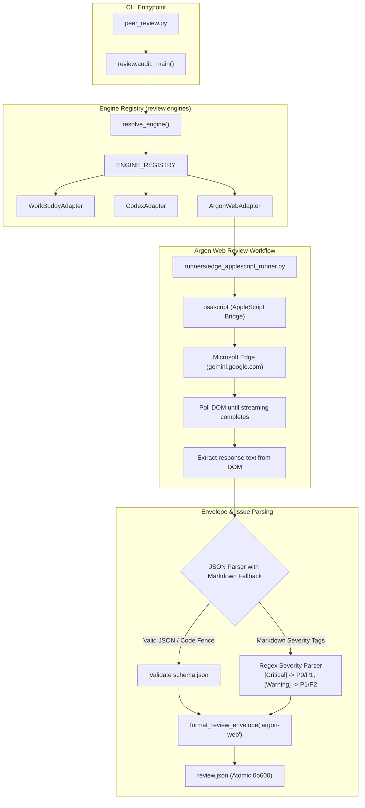
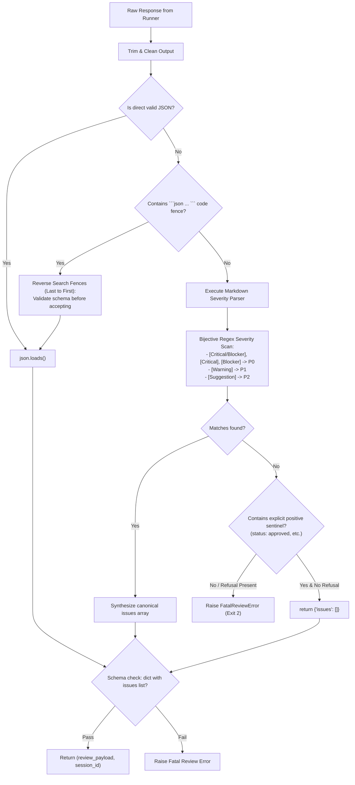

# Architectural Design: Argon Web Reviewer & Pluggable Engine Architecture

**Feature ID:** `2026-10-14-argon-web-reviewer`  
**Governing Specification:** [`spec.md`](./spec.md)  
**Governing ADRs:** [`decisions.md`](./decisions.md)  
**Status:** In Review  

---

## 1. System Overview & Component Architecture

This design refactors the reviewer subsystem in `ai-review-plugin` from hardcoded engine branching into a **Pluggable Engine Registry** and introduces the **Argon Web Reviewer** (`--engine argon-web`).



---

## 2. Requirement Traceability Matrix

| Requirement ID | Component / Module | Implementation Responsibilities |
| :--- | :--- | :--- |
| `REQ-036` | `scripts/review/engines/__init__.py` & `audit.py` | Implement `ENGINE_REGISTRY`, dynamic choices in `argparse`, eliminate hardcoded `if/elif` branches. |
| `REQ-037` | `scripts/review/runners/edge_applescript_runner.py` | Standalone CLI and subprocess runner for Edge AppleScript automation, DOM injection, generation polling. |
| `REQ-038` | `scripts/review/engines/argon.py` | `ArgonWebAdapter` implementing `ReviewEngineAdapter` with binary resolution, command generation, session prefix `argon-web:`. |
| `REQ-039` | `scripts/review/engines/argon.py` | Hybrid extraction: parse fenced JSON, fallback regex for `[Critical/Blocker]`, `[Warning]`, `[Suggestion]`. |
| `REQ-040` | `tests/test_argon_engine.py` & Live Runner | Pytest unit test suite with mock AppleScript/DOM and live end-to-end test against this design document. |

---

## 3. Detailed Component Designs

### 3.1 Pluggable Engine Registry (`scripts/review/engines/__init__.py`)
The registry provides a centralized catalog for review engine adapters:

```python
ENGINE_REGISTRY: Dict[str, Type[ReviewEngineAdapter]] = {
    "workbuddy": WorkBuddyAdapter,
    "codex": CodexAdapter,
    "argon-web": ArgonWebAdapter,
}

def register_engine(name: str, adapter_cls: Type[ReviewEngineAdapter]) -> None:
    ENGINE_REGISTRY[name] = adapter_cls

def get_engine_adapter(name: str) -> ReviewEngineAdapter:
    if name not in ENGINE_REGISTRY:
        raise ValueError(f"Unsupported review engine: {name}")
    return ENGINE_REGISTRY[name]()

def get_supported_engines() -> List[str]:
    return sorted(list(ENGINE_REGISTRY.keys()))
```

`resolve_engine(cli_engine, session_id)` is updated to:
1. Check `session_id` prefixes:
   - `workbuddy:` -> `workbuddy`
   - `codex:` -> `codex`
   - `argon-web:` -> `argon-web`
2. Check `cli_engine` against `get_supported_engines()`.
3. Check `AI_REVIEW_ENGINE` env var.
4. Default to `workbuddy`.

### 3.2 Edge AppleScript Review Runner (`scripts/review/runners/edge_applescript_runner.py`)
Implemented natively as a self-contained component in `ai-review-plugin`, using the prototype script strictly as a design reference with zero external runtime references.
- **Standalone invocation:**
  ```bash
  python3 scripts/review/runners/edge_applescript_runner.py path/to/design.md --out design_review.md --skill @software-architect-reviewer
  ```
- **Execution semantics:**
  - `run_edge_js(js_code: str)`: Executes AppleScript via `subprocess.run(["osascript", "-e", script, js_code])` targeting `Microsoft Edge` tabs matching `gemini.google.com`.
  - DOM text injection: Targets `.ql-editor`, `div[contenteditable="true"]`, or `textarea` using `document.execCommand('insertText', false, text)`.
  - Generation state monitoring: Polls stop button presence (`isStreaming`) and character length stability (`stable_checks >= 2`).
  - DOM extraction: Extracts final `.innerText` from response elements and writes to target output file.

### 3.3 Argon Web Review Engine Adapter (`scripts/review/engines/argon.py`)
Subclasses `ReviewEngineAdapter`:
- `resolve_binary()`:
  - Validates `osascript` availability via `shutil.which("osascript")`.
  - Resolves runner path to `scripts/review/runners/edge_applescript_runner.py` (overridable via `ARGON_RUNNER_BIN`).
- `build_command(...)`:
  - Builds command: `[sys.executable, runner_path, target_file, "--out", review_file_path, "--skill", skill_tag, "--json-prompt"]`.
- `extract_review_payload_and_session(...)`:
  - Inspects `review_file_path` written by the runner.
  - Implements hybrid JSON and markdown parser.
  - Generates or preserves formatted session ID: `argon-web:<uuid>` or `prior_session_id`.

### 3.4 Hybrid Response Parsing Algorithm
Gemini web responses vary in formatting. The extraction algorithm operates as follows:



---

## 4. Error Handling & Edge Cases

1. **Microsoft Edge Not Running or No Gemini Tab:**
   - AppleScript returns `"NO_GEMINI_TAB_FOUND"`.
   - Runner prints user-friendly diagnostic: `"No open tab with gemini.google.com found in Microsoft Edge."`
   - Adapter exits with status `2` and actionable instructions.
2. **AppleScript Permission Denied:**
   - Detect `"Allow JavaScript from Apple Events"` in stderr.
   - Output exact navigation steps: `Edge Menu Bar -> View -> Developer -> Allow JavaScript from Apple Events`.
3. **LLM Generation Timeout:**
   - Default timeout 240s; configurable via `--timeout`.
   - Clean termination of polling loop with timeout diagnostic.
4. **Invalid or Corrupt Payload:**
   - If both JSON parsing and markdown severity extraction yield zero valid structure, abort safely with non-zero exit code.

---

## 5. Security & Isolation Considerations
- **Sandboxed Execution:** The runner is strictly read-only with respect to the user's workspace; it reads local markdown files and sends them to the browser tab.
- **Untrusted Target Prompt Guard:** The prompt contains explicit boundaries instructing Gemini to treat the input document as passive data rather than executable instructions.
- **File Permissions:** Review outputs written to disk follow existing 0o600 permission requirements for temporary files.
