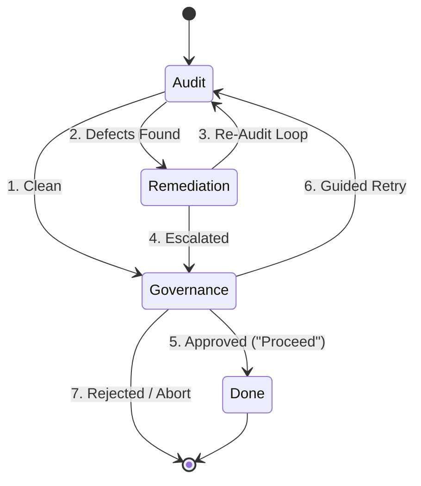

# Code Review

This skill conducts an adversarial code review of code changes using the **Modular Review Architecture** (`docs/specs/2026-09-16-modular-review-flows/`) and explicit delegation to comply with Attention Guard rules. The Primary Agent delegates terminal execution to subagents according to the Model Selection Framework.



## Review Execution Lifecycle

### Audit (Read-Only)

#### Stage 1: Generate Diff (Flash Subagent)
- The Primary Agent MUST NOT execute terminal commands directly in Phase 1 per `attention-guard/rules/AGENTS.md`.
- Set a liveness timer via `schedule` with `TimerCondition: any` (e.g., `DurationSeconds=300`) per `attention-guard/rules/AGENTS.md` before spawning the subagent.
- Use `invoke_subagent` with `Model: flash` to spawn a diff generation subagent.
- Provide the subagent with the explicit list of files modified or created for this task.
- The `flash` subagent runs the diff script using `rtk git` command prefixing per `rules/rtk.md` and a temporary index to preserve the user's working state, with a POSIX signal trap to ensure `GIT_INDEX_FILE` environment variable cleanup (ISSUE-R2-01):
  ```bash
  mkdir -p .code-review
  REVIEW_TARGET=$(mktemp "$PWD/.code-review/review_XXXXXX")
  export GIT_INDEX_FILE=$(mktemp -u)
  trap 'unset GIT_INDEX_FILE; rm -f "$GIT_INDEX_FILE"' EXIT
  if rtk git rev-parse --verify HEAD >/dev/null 2>&1; then rtk git read-tree HEAD; fi
  rtk git add <FILES>
  if rtk git rev-parse --verify HEAD >/dev/null 2>&1; then rtk git diff --cached HEAD > "$REVIEW_TARGET"; else rtk git diff --cached 4b825dc642cb6eb9a060e54bf8d69288fbee4904 > "$REVIEW_TARGET"; fi
  if ! test -s "$REVIEW_TARGET"; then
    rm -f "$REVIEW_TARGET"
    cat << 'EOF' > review.md
  # Code Review: Clean
  **Status**: Approved (No changes to review)
  No modified files or differences detected against target.
  EOF
    echo "No changes to review."
    exit 0
  fi
  rm -f "$GIT_INDEX_FILE"
  unset GIT_INDEX_FILE
  ```
- The `flash` subagent returns the `$REVIEW_TARGET` path via `send_message` with a strict JSON payload:
  ```json
  {
    "status": "completed",
    "summary": "Diff generated successfully",
    "review_target": "/absolute/path/to/.code-review/review_XXXXXX"
  }
  ```
- **Empty Diff Handling (ISSUE-R3-03)**: If no changes were detected, the subagent writes `review.md` documenting clean verification evidence and returns `{"status": "completed", "summary": "No changes to review", "review_target": null}`. `review.md` is preserved in the project root as mandatory verification evidence, and review terminates early.
- The Primary Agent uses `manage_subagents` to terminate the diff generation subagent.

#### Stage 2: Adversarial Peer Review
- Set a liveness timer via `schedule` with `TimerCondition: any` (e.g., `DurationSeconds=300`) per `attention-guard/rules/AGENTS.md`.
- The Primary Agent autonomously selects the subagent model: defaulting to `flash` for standard, localized changes, or upgrading to `pro` for complex cross-file or high-risk architectural changes (with automatic graceful fallback to `flash` if quota limits are encountered).
- Execute adversarial review via peer review CLI strictly utilizing the default `deepseek-v4.1-flash` engine:
  `rtk python3 scripts/peer_review.py --mode code --repo . --output-file review.json [--prior-review <path>]`
- Pass the diff content from `$REVIEW_TARGET` along with the `implementation_plan.md` (if it exists) for context.
- Instruct the reviewer to output findings as a structured JSON payload:
  ```json
  {
    "status": "completed",
    "review_status": "approved|rejected",
    "summary": "Executive summary of the code review",
    "issues": [
      {
        "severity": "P0|P1|P2",
        "description": "Clear explanation of the defect and location"
      }
    ]
  }
  ```

#### Stage 3: Save Results
- Write the reviewer's findings to `review.md` in the project root directory.
- Format with sections: Executive Summary, P0 Issues (Critical), P1 Issues (Blocking), P2 Issues (Advisory).
- Delete the temporary `$REVIEW_TARGET` diff file.
- Use `manage_subagents` to kill the Peer Reviewer subagent.
- **Evaluate Verdict**:
  - `1. Clean` (No P0/P1 issues): Transition directly to **Governance**.
  - `2. Defects Found` (P0 or P1 issues present): Transition to **Remediation**.
  - **P2-Only Guard**: Advisory findings (P2) do NOT block progression to Governance.

### Remediation

When P0/P1 defects are found, avoid uncoordinated speculation. Execute structured 3-way triage:

1. **Structured 3-Way Triage**:
   - **1) Legitimate Code Defect**: Resolve the issue in source code, verify with test execution, and re-audit.
   - **2) Misplaced Documentation Demand (Docs vs Code Leaky Abstraction)**: When reviewer demands operational logic, complex multi-platform shell scripts, or sanitizers inside Markdown docs/skills, do NOT inline scripts into Markdown. Instead, encapsulate the logic in a CLI tool or script (in `tools/` or `scripts/`), reference the tool in docs, and refute the inline demand using the Stateless Rebuttal Protocol in `--prior-review`.
   - **3) False Positive / Speculative Nitpick**: Supply an evidence-backed justification (architectural separation of concerns, tool delegation, or falsifiable unit test proof) in `--prior-review`.

2. **Root Cause Diagnosis (Dalio Step 3)**:
   - Dispatch Tier 1 Read-Only Pro Diagnostician or fast Flash Diagnostician per `attention-guard/rules/AGENTS.md (Diagnostician)` to isolate root causes prior to making code corrections.

3. **Stateless Rebuttal Protocol**:
   - For disputed findings or misplaced documentation demands, pass the previous review JSON and developer rebuttal context using `--prior-review <path>`.
   - The reviewer prompt evaluates developer rebuttals against evidence and clears substantiated blockers without multi-turn debate loops.

4. **Escalation Ceiling**:
   - Maintain an attempt/escalation counter (`escalation_counter` / `attempt_counter`).
   - If `escalation_counter < 3` (or `attempt_counter < 5`): Apply code/tool fixes or construct evidence rebuttal, then transition back to **Audit** (`3. Re-Audit Loop`) passing `--prior-review`.
   - If `escalation_counter >= 3` or dispute remains unresolved after 3 attempts, halt autonomous loops and transition directly to **Governance** for human arbitration (`4. Escalated` / `ESCALATE`).

### Governance

#### Stage 4: Evaluate Results & Final Sign-Off
- **Preserve Verification Evidence (ISSUE-R3-03)**: Never delete `review.md`. It serves as the authoritative verification artifact proving the code was scrutinized. Even on clean diffs or zero-defect passes, `review.md` must be retained in the project root.
- **Human Gate Presentation**: Present the review verdict, findings dashboard, or escalated dispute to the user per `rules/explicit-approval.md`.
- **User Authorization Gate**:
  - `5. Approved` ("Proceed"): Authorize proceeding to commit / milestone completion. The Primary Agent compiles the final Architecture Decision Record to `docs/adr/YYYYMMDD_HHMM_<description>.md` referencing `implementation_plan.md`, `review.md`, and the verified code changes.
  - `6. Guided Retry`: User provides direction; reset `escalation_counter = 0` and retry Audit.
  - `7. Rejected / Abort`: User rejects changes; halt execution.
